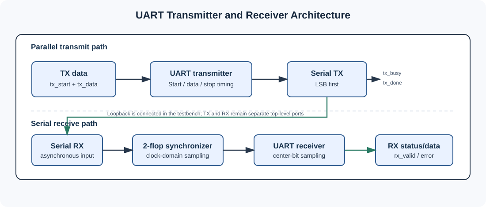

# UART Transmitter and Receiver

[](https://github.com/saiv9/UART-Transmitter-and-Receiver-Verilog/actions/workflows/uart-simulation.yml)

A basic UART transmitter and receiver implemented in Verilog HDL. The design uses one start bit, eight data bits by default, one stop bit, and least-significant-bit-first data transmission.

## Design features

- Separate transmitter and receiver modules
- Configurable clock cycles per serial bit and data width
- Idle-high TX output with `tx_busy` and one-cycle `tx_done` status
- Two-flop synchronizer on the asynchronous RX input
- Mid-bit start validation and data sampling
- One-cycle `rx_valid` pulse for valid frames
- Framing-error indication when the stop bit is low
- Self-checking loopback and invalid-stop-bit tests

## Architecture



The transmitter converts a parallel word into a serial frame. The receiver synchronizes the serial input, validates the start bit near its midpoint, samples each data bit, and checks the stop bit. The top-level module exposes independent TX and RX pins. The testbench connects TX to RX for loopback checks.

## Interface

### Parameters

| Parameter | Default | Description |
|---|---:|---|
| `CLKS_PER_BIT` | 16 | System-clock cycles per serial bit; must be at least 2 |
| `DATA_BITS` | 8 | Number of data bits per frame |

The divider is calculated from the system clock and target baud rate:

`CLKS_PER_BIT = CLOCK_FREQUENCY / BAUD_RATE`

This implementation uses an integer divider. The selected clock and baud rate should therefore be checked for divider error. The default value is a simulation setting, not a board-specific baud-rate configuration.

### Top-level signals

| Signal | Direction | Description |
|---|---|---|
| `clk` | Input | System clock |
| `rst_n` | Input | Asynchronous active-low reset |
| `tx_start` | Input | Starts a frame when the transmitter is idle |
| `tx_data` | Input | Parallel word to transmit |
| `rx` | Input | Asynchronous serial input |
| `tx` | Output | Serial output, idle high |
| `tx_busy` | Output | High while a frame is being transmitted |
| `tx_done` | Output | One-clock pulse after the stop bit |
| `rx_data` | Output | Most recently received word |
| `rx_valid` | Output | One-clock pulse for a valid frame |
| `framing_error` | Output | One-clock pulse if the stop bit is low |

## Run the simulation

Install Icarus Verilog, then run from the repository root:

```bash
bash scripts/run_sim.sh
```

The self-checking testbench verifies loopback for `00`, `FF`, `A5`, `3C`, and `96`, checks TX completion, and injects a frame with an invalid stop bit. A successful run reports five loopback passes and one framing-error pass.

The VCD waveform and simulation log are written to `build/`. GitHub Actions runs the same testbench and uploads both files as an artifact.

## Repository layout

```text
rtl/uart_tx.v                  Transmitter
rtl/uart_rx.v                  Receiver
rtl/uart_top.v                 Top-level integration
tb/tb_uart_top.v               Self-checking testbench
docs/architecture.svg          Block diagram
docs/verification-plan.md       Verification cases
scripts/run_sim.sh              Local simulation script
.github/workflows/              Automated simulation
```

## Scope

This project covers a basic asynchronous UART frame. It does not include parity, a configurable stop-bit count, FIFO buffering, hardware flow control, or automatic baud-rate detection. Verification is simulation-based; no physical FPGA board test or timing-closure result is claimed.

## License

MIT. See [LICENSE](LICENSE).
